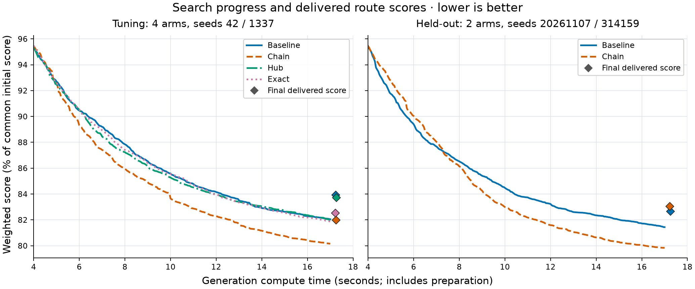

# Route algorithm comparison: 2026-11-07

**The measured candidate did not reliably beat the baseline under the declared
criteria.** Optional-chain insertion won tuning selection, then produced a
0.456956% worse geometric-mean weighted score on the held-out panel. Its
geometric-mean player time improved by 1.273725%, but only four of eight profiles
had positive two-seed mean score savings, and the worst paired score regression
was 30.994428%. These measurements do not support a default replacement.

All 104 planned pilot, tuning, and held-out runs completed, with no execution or
resource failures and a clean independent accounting audit. Production defaults
remain unchanged.

## Question and scope

Can bounded optional-chain insertion, bounded nearby-quest repair, or disabling
the approximate evaluation screen improve route quality within the same
generation allowance on the corrected simulator?

This experiment compares the existing **single-start search kernel** with three
alternatives. Every arm uses the same greedy bootstrap, simulator, cleanup, and
production finalization sequence. The application's default multi-start
tournament is outside this comparison. A kernel result alone cannot establish
superiority over that production tournament or justify a production default
change. The selected candidate failed this first gate, so no production-tournament
validation was needed for the decision to retain current defaults.

The comparison holds game data and simulation semantics fixed. Both new
operators default to zero probability. BiS is disabled for every arm to isolate
search from the outstanding vendor-data reconciliation. The panel covers solo
melee and caster routes, both factions, both editions, and different level
ranges. It does not establish results for group routes, profession goals,
explicitly forced content, vendor purchases, every class, or other budgets.

The prior [search-alternatives assessment](route-search-alternatives-2026-11-07.md)
contains the motivating algorithm inspection and research links. The
[implementation and experiment plan](superpowers/plans/2026-11-07-route-algorithm-comparison.md)
records the bounded operators, review requirements, and experiment contract.

## Frozen method

### Compared arms

| Arm | Difference from the common baseline |
| --- | --- |
| Baseline | Existing search, with both experimental probabilities zero. |
| Chain | `chain_insert=0.05`: bounded insertion of an omitted optional quest and its missing prerequisite bundle. |
| Hub | `hub_repair=0.02`: bounded reconstruction of two or three eligible nearby optional quests, with at most six insertion-order permutations. |
| Exact | `eval_window=0`: disable approximate screening and evaluate affected route suffixes exactly. Both new operators remain disabled. |

Chain and hub probabilities apply to small-move dispatcher calls. With the
default 25% ALNS probability, their expected overall proposal frequencies are
approximately 3.75% and 1.5%, respectively. Each experimental arm enables one
change; this experiment does not select a combination after seeing results.

The chain collector allows at most eight newly inserted quests, depth sixteen,
and sixty-four branch visits. Candidate simulation remains authoritative. Hub
repair preserves the selected stop multiset and excludes timed, linked,
dungeon, initial-log, and partial quests in this implementation.

### Profile panel

Each row is one profile, with two tuning seeds and two held-out seeds. The
requests specify race, class, and level range; effective parameters and request
identities are captured by the frozen manifest.

| Profile ID | Edition | Race and class | Faction | Levels |
| --- | --- | --- | --- | --- |
| `classic-human-warrior-1-30` | Classic | Human Warrior | Alliance | 1–30 |
| `classic-undead-mage-1-40` | Classic | Undead Mage | Horde | 1–40 |
| `classic-orc-warrior-20-40` | Classic | Orc Warrior | Horde | 20–40 |
| `classic-gnome-mage-20-40` | Classic | Gnome Mage | Alliance | 20–40 |
| `forever-human-warrior-1-30` | Forever | Human Warrior | Alliance | 1–30 |
| `forever-undead-mage-1-40` | Forever | Undead Mage | Horde | 1–40 |
| `forever-orc-warrior-20-40` | Forever | Orc Warrior | Horde | 20–40 |
| `forever-gnome-mage-20-40` | Forever | Gnome Mage | Alliance | 20–40 |

Tuning uses seeds `42` and `1337`, all four arms, and all eight profiles: 64 runs.
Arm order is counterbalanced in the frozen run order. Candidate selection uses
tuning only and freezes one arm for the whole panel, rather than choosing a
different winner for each profile. The plan retains a clearly labeled negative
or inconclusive held-out comparison if no arm satisfies basic feasibility and
resource criteria.

Held-out evaluation uses seeds `20261107` and `314159`, the frozen candidate and
baseline, and all eight profiles: 32 runs forming sixteen paired comparisons.
AB/BA order alternates. Held-out outcomes cannot change the selected arm or its
parameters. Seeds are replicates within profiles, not sixteen independent
profiles.

### Budget and resource accounting

All timed planner processes run strictly sequentially with one search worker.
No compiler or other planner job overlaps them. Each fresh process has the same
cache policy and frozen executable. Process order is recorded rather than
silently rearranged after unfavorable results.

| Rule | Frozen value |
| --- | --- |
| Full measured computation allowance | 20 seconds per run |
| Uniform reserve for finishing work | 3 seconds; search cutoff at 17 seconds from the common computation start |
| Computation overrun tolerance | 0.25 seconds; more than 20.25 seconds is a violation |
| Peak-memory limit | 1.5 GiB, or 1,610,612,736 bytes |
| Parent timeout | Allowance plus 10 seconds, or 30 seconds |

Measured computation includes preparation, construction, search cleanup, common
finalization, exact final replay, required-content validation, and export.
Preparation and construction are deducted from available search time. The
uniform reserve is an allowance for finishing work, not additional search time.
Serialization and process overhead are recorded separately, together with
parent wall time. A search-only timer cannot establish compliance.

The common finalization sequence merges visits, tidies the route, groups
objectives, and validates requirements in production order. Exact final replay
provides the reported score and player time. Cleanup and tidying may
intentionally trade a little score for guide quality, so the finalized endpoint
takes precedence over an earlier best-score callback.

All eight pilots passed. Their recorded parent wall times were approximately
17.2–17.7 seconds and peak working sets approximately 281–333 MiB. The protocol
was frozen at the original 20-second allowance and 3-second reserve, with no
adjustment. Pilots establish execution feasibility; they do not establish a
route-quality advantage.

### Measurements and fixed decision criteria

The primary endpoint is exact final optimizer score, including player time,
weighted costs, and terminal penalties. Lower score is better. Player time is
reported separately. Aggregation gives each profile equal weight and uses
paired candidate-to-baseline score ratios. A positive reported gain means the
candidate's score is lower.

A practical broader win must satisfy every frozen criterion:

1. At least 1% equal-profile geometric-mean score improvement.
2. Positive two-seed mean improvement in at least six of eight profiles.
3. No individual paired score regression above 2%.
4. No player-time geometric-mean regression above 0.25%.
5. No new feasibility, required-content, memory, or budget failures.

The report retains all failures, missing-content changes, overruns, and
unfavorable pairs. Win/tie/loss uses a 0.5-score-unit threshold. Stable warning
identities distinguish content changes from route-dependent explanatory prose.
Soft class and zone requirements are reported alongside hard validation.

Supporting measurements include score penalties and their components, player
time, completions, grinding and over-cap grinding, travel, zone changes,
warnings, required content, purchases and spend, final copper, generation stage
times, search tries, peak working set, and best-score-over-time callbacks. The
BiS-off control means purchase metrics are not evidence about vendor routing.
The final analysis must show medians, worst regressions, and all sixteen held-out
pairs; averages cannot replace those checks.

These are practical criteria for this panel and budget. Near-threshold or
case-dependent findings remain inconclusive. Neither a positive result nor a
negative result proves that a solver is globally optimal or that no better
algorithm exists.

## Frozen identity and verification

The corrected starting revision is `d1c733c`. The reviewed experiment source is
`a3ce9878830b3414b4b200d9fbbfd1febc88cb58` on
`experiment/route-quality-comparison`. Documentation edits are excluded from the
frozen experiment source identity; code, runner, executable, and game data remain
fixed throughout tuning and held-out execution.

| Artifact | SHA-256 |
| --- | --- |
| Release comparison executable | `a18e001ffd1ef476ce7c0509b4fa3246e633b91c74e9b0951ca5187da6b79e66` |
| Python runner | `1363e80042aa42edf77cba616471cb15f55949e432bc4fdd762045bf33fb4fb0` |
| Classic database | `226f4c361aa84667b694a45661d5be589cbe999042f3ed161445dc5eb1f585b9` |
| Forever database | `1c93c95bfa5d236728ce75d0d9059133a070cff9aa7fdaf62be902f7c3582db7` |
| Pilot result artifact | `d1764eb1872afb1d2f28d9709c334bf077ffce6280ac78111012d20dc542cbca` |

The durable [frozen protocol](route-comparison-2026-11-07/protocol.json) includes
the source/override hashes, requests, run order, and limits. The
[candidate selection](route-comparison-2026-11-07/candidate.json),
[complete analysis](route-comparison-2026-11-07/analysis.json),
[independent final audit](route-comparison-2026-11-07/audit-final.json),
[paired measurements](route-comparison-2026-11-07/paired.csv), and
[anytime measurements](route-comparison-2026-11-07/anytime.csv) retain the compact
evidence. Full per-run requests, guides, traces, logs, timing sidecars, and
append-only `runs.jsonl` remain in the ignored local directory
`.superpowers/sdd/2026-11-07-route-algorithm-comparison/results`.

The machine is Windows
on an AMD Ryzen 7 9800X3D, with eight physical cores and eight logical processors
exposed to the environment. Toolchain
versions are Rust 1.99.0 (`b940084d7`, 2026-09-28) and Python 3.14.0.

Fresh pre-pilot verification passed format checks, release Clippy for all route
targets with warnings denied, 302 library tests, 238 integration tests, three
Rust example tests, fourteen Python protocol checks, and the release example
build. One known Windows newline test,
`export::fgstring::tests::the_addon_reads_them_and_they_read_the_addon`, was
explicitly skipped. Two documentation examples remain ignored. These exceptions
are not counted as passes.

Implementation and harness received independent reviews. Four Important
findings concerned linked-partner cycle/bounds preflight, per-member OR
prerequisites, stable warning comparisons, and exceptional child-process cleanup.
All four fixes were re-reviewed as addressed. The remaining Minor observation
is route scanning in neighborhood eligibility; the bounded operator's measured
cost is part of the comparison. No game-data or production-default change is
part of the experiment.

## Tuning results

All 64 tuning runs completed. Each alternative has sixteen valid paired
comparisons across eight profiles. Percent gains below are
`100 × (1 − candidate/baseline ratio)`: positive means a lower score or shorter
player time. Score units are seconds of weighted cost, not necessarily seconds
of gameplay.

| Candidate | Score gain | Player-time gain | Positive profiles | Worst score regression | Win/tie/loss |
| --- | --- | --- | --- | --- | --- |
| Chain | +2.297914% | +1.179006% | 7/8 | 5.395765% | 10/0/6 |
| Hub | +0.238812% | −0.112224% | 3/8 | 3.415577% | 7/0/9 |
| Exact | +1.676961% | +0.698252% | 5/8 | 3.414389% | 10/0/6 |

Median paired score savings were 2,144.04 for chain, −1,303.51 for hub, and
1,220.77 for exact. All arms passed basic feasibility, warning, and resource
checks. None satisfied every practical-win criterion even during tuning: all
three exceeded the 2% worst-regression limit. Hub also missed the aggregate
gain and profile-count thresholds; exact missed the profile-count threshold.

### Frozen candidate selection

The runner froze **chain** at `chain_insert=0.05` because it had the lowest
equal-profile geometric-mean finalized score among feasible arms. Feasibility
here means complete paired results without new validation, content, or resource
failures; it does not mean passing every practical-win threshold. Chain's
tuning score ratio was `0.977020855722068`, compared with
`0.9832303877947716` for exact and `0.9976118770024527` for hub.

Selection preceded held-out execution. The selection binds to protocol SHA-256
`3d8c986306acba1479f84cf192bb36efdc05264e19cdd245a230b55b4c7ff26b`
and the pre-held-out run-log prefix SHA-256
`0955a47294ae8291602530644cb883df41e68250192a74b39394666a7f4dec16`.
The independent audit verified those prefix identities. No arm or parameter was
changed after the held-out seeds were opened. Hub and exact did not receive
held-out evaluation in this bounded experiment.

## Held-out paired results

All sixteen pairs were usable, with no new failure. The candidate is chain in
every row. Scores and player times below come from authoritative final replay;
they are displayed to two decimal places, with full precision in the
[paired CSV](route-comparison-2026-11-07/paired.csv). Positive gains mean an
improvement in every table.

### Classic finalized weighted scores

| Race, class, and levels | Seed | Baseline score | Chain score | Score gain |
| --- | --- | --- | --- | --- |
| Human Warrior 1–30 | 20261107 | 137,784.69 | 133,326.44 | +3.236% |
| Human Warrior 1–30 | 314159 | 136,528.12 | 137,272.06 | −0.545% |
| Undead Mage 1–40 | 20261107 | 224,462.67 | 228,167.95 | −1.651% |
| Undead Mage 1–40 | 314159 | 223,651.35 | 221,103.09 | +1.139% |
| Orc Warrior 20–40 | 20261107 | 167,281.62 | 201,070.13 | −20.199% |
| Orc Warrior 20–40 | 314159 | 217,985.58 | 199,263.45 | +8.589% |
| Gnome Mage 20–40 | 20261107 | 158,325.94 | 153,256.85 | +3.202% |
| Gnome Mage 20–40 | 314159 | 160,830.06 | 154,210.36 | +4.116% |

### Classic player times

| Race, class, and levels | Seed | Baseline seconds | Chain seconds | Player-time gain |
| --- | --- | --- | --- | --- |
| Human Warrior 1–30 | 20261107 | 107,253.35 | 102,556.75 | +4.379% |
| Human Warrior 1–30 | 314159 | 105,241.59 | 105,492.75 | −0.239% |
| Undead Mage 1–40 | 20261107 | 191,269.66 | 191,490.81 | −0.116% |
| Undead Mage 1–40 | 314159 | 190,886.61 | 186,298.52 | +2.404% |
| Orc Warrior 20–40 | 20261107 | 144,079.20 | 151,423.27 | −5.097% |
| Orc Warrior 20–40 | 314159 | 158,297.72 | 151,572.59 | +4.248% |
| Gnome Mage 20–40 | 20261107 | 130,774.46 | 128,071.66 | +2.067% |
| Gnome Mage 20–40 | 314159 | 130,933.26 | 128,351.83 | +1.972% |

### Forever finalized weighted scores

| Race, class, and levels | Seed | Baseline score | Chain score | Score gain |
| --- | --- | --- | --- | --- |
| Human Warrior 1–30 | 20261107 | 143,461.90 | 144,468.44 | −0.702% |
| Human Warrior 1–30 | 314159 | 142,741.54 | 139,288.41 | +2.419% |
| Undead Mage 1–40 | 20261107 | 255,254.47 | 222,977.59 | +12.645% |
| Undead Mage 1–40 | 314159 | 232,642.96 | 227,600.68 | +2.167% |
| Orc Warrior 20–40 | 20261107 | 168,067.83 | 173,268.30 | −3.094% |
| Orc Warrior 20–40 | 314159 | 167,871.60 | 172,328.97 | −2.655% |
| Gnome Mage 20–40 | 20261107 | 169,640.22 | 222,219.24 | −30.994% |
| Gnome Mage 20–40 | 314159 | 174,297.26 | 161,512.93 | +7.335% |

### Forever player times

| Race, class, and levels | Seed | Baseline seconds | Chain seconds | Player-time gain |
| --- | --- | --- | --- | --- |
| Human Warrior 1–30 | 20261107 | 112,393.66 | 113,289.10 | −0.797% |
| Human Warrior 1–30 | 314159 | 112,426.70 | 110,582.51 | +1.640% |
| Undead Mage 1–40 | 20261107 | 207,895.39 | 189,732.49 | +8.737% |
| Undead Mage 1–40 | 314159 | 198,359.46 | 193,526.59 | +2.436% |
| Orc Warrior 20–40 | 20261107 | 143,866.48 | 149,389.89 | −3.839% |
| Orc Warrior 20–40 | 314159 | 144,420.50 | 147,881.22 | −2.396% |
| Gnome Mage 20–40 | 20261107 | 143,100.84 | 147,295.15 | −2.931% |
| Gnome Mage 20–40 | 314159 | 147,033.37 | 137,011.22 | +6.816% |

### Profile aggregates and declared decision

Profile percentage gains use the geometric mean of that profile's two paired
ratios. The runner counts positive profiles from the arithmetic mean of paired
score savings (`score_delta`, populated in these records); its relative-gain
fallback applies only when that field is absent. The mean absolute savings
column is also shown for scale. All eight profile classifications agree with
both mean relative gains and geometric ratios in this held-out panel.

| Edition and profile | Score gain | Player-time gain | Mean score saving |
| --- | --- | --- | --- |
| Classic Human Warrior 1–30 | +1.363496% | +2.097382% | +1,857.16 |
| Classic Undead Mage 1–40 | −0.245964% | +1.152000% | −578.51 |
| Classic Orc Warrior 20–40 | −4.821315% | −0.315647% | −7,533.19 |
| Classic Gnome Mage 20–40 | +3.659901% | +2.019172% | +5,844.39 |
| Forever Human Warrior 1–30 | +0.871047% | +0.429280% | +1,223.29 |
| Forever Undead Mage 1–40 | +7.554505% | +5.639055% | +18,659.58 |
| Forever Orc Warrior 20–40 | −2.874515% | −3.115244% | −4,828.92 |
| Forever Gnome Mage 20–40 | −10.175439% | +2.063802% | −19,897.35 |

| Frozen criterion | Measured value | Met? |
| --- | --- | --- |
| At least 1% equal-profile geometric-mean score improvement | −0.456956% improvement; ratio `1.0045695621516497` | No |
| Positive two-seed means in at least six of eight profiles | 4/8 | No |
| Worst paired score regression at most 2% | 30.994428% | No |
| Player-time geometric-mean regression at most 0.25% | 1.273725% faster; ratio `0.9872627527219172` | Yes |
| No new feasibility, required-content, memory, or budget failures | None found | Yes |

There were nine score wins, no ties, and seven losses. The median paired score
saving was +3,000.69. The best paired saving was +32,276.88 for Forever Undead
Mage, seed `20261107`; the worst was −52,579.02 for Forever Gnome Mage on the
same seed. The positive median and majority of pair wins do not offset the
failed aggregate and regression criteria.

## Resource measurements and independent audit

Every measured computation finished within the 20-second allowance. Across all
104 runs, computation ranged from 17.104364 to 17.631988 seconds, parent wall
time from 17.152873 to 17.702733 seconds, and peak working set from 279.0 to
348.1 MiB. No run exceeded the 20.25-second tolerance or 1.5 GiB memory cap.

The comparison uses the same computation ceiling and 17-second search cutoff;
it does not force identical completion instants. Finishing consumed less than
the reserved three seconds in this panel. Unused reserve was not reinvested in
search for any arm, so these results do not describe fully spending every
available 20-second interval.

The following rows each summarize sixteen runs. Computation and memory show
median followed by minimum–maximum; parent wall time shows minimum–maximum.
Different try counts are expected at equal time allowances and are not used to
normalize route quality.

| Phase and arm | Compute seconds | Parent wall seconds | Peak memory MiB | Median search tries |
| --- | --- | --- | --- | --- |
| Tuning baseline | 17.239 (17.104–17.526) | 17.153–17.606 | 316.7 (282.6–344.5) | 87,256.5 |
| Tuning chain | 17.255 (17.121–17.549) | 17.192–17.621 | 319.1 (281.9–344.3) | 78,023 |
| Tuning hub | 17.266 (17.125–17.521) | 17.173–17.583 | 310.7 (282.0–342.3) | 72,070.5 |
| Tuning exact | 17.224 (17.115–17.587) | 17.183–17.662 | 313.8 (279.0–348.1) | 64,950.5 |
| Held-out baseline | 17.253 (17.108–17.556) | 17.163–17.624 | 317.7 (284.7–336.3) | 84,951.5 |
| Held-out chain | 17.234 (17.117–17.566) | 17.167–17.648 | 316.2 (290.3–345.5) | 81,186 |

Measured stage ranges below include all 104 runs; their extrema need not occur
in the same run. Search includes its cleanup. Serialization/write is outside
the computation timer and is shown separately.

| Stage | Minimum seconds | Maximum seconds |
| --- | --- | --- |
| Input and data loading | 0.001775 | 0.007244 |
| Preparation | 1.013234 | 1.908452 |
| Planner initialization and construction | 0.910852 | 2.554430 |
| Search including cleanup | 12.624109 | 15.057891 |
| Common finalization | 0.076027 | 0.489124 |
| Exact traced replay | 0.000404 | 0.001533 |
| Validation and warnings | 0.000891 | 0.005359 |
| Export | 0.003557 | 0.015653 |
| Serialization and artifact write, outside computation | 0.007002 | 0.017770 |

The independent audit found zero issues and zero independently derived run
failures. It checked all 104 request hashes, result hashes, embedded results,
and timing sidecars; the expected 8/64/32 phase counts and unique schedules;
pilot/tuning prefix identities; and the current frozen executable and runner
hashes. All seventy candidate-versus-baseline bootstrap callback comparisons
and effective-parameter comparisons matched their declared differences. Final
`breakdown.total` matched player time, and stage sums matched computation within
approximately 0.6–2.1 microseconds of untimed scalar overhead.

No comparison introduced a missing-content or warning ID. Human Warrior 1–30
retained the existing missing-class warnings for quests `1718` and `1719` in
both editions and both arms. The sole warning-ID difference removed late-timed
quest `212` from Forever Gnome Mage, seed `314159`, in the chain arm. Soft warning
absence is distinct from hard required-content validation, which passed in every
run. Every run had `required_quest_count=0`, so there is **no empirical coverage
of explicit hard-required quest requests** in this panel. The validator and unit
tests exercise related behavior, but their existence does not extend the
measured panel's coverage. Full warning and breakdown values remain in the
linked evidence.

### Search bests and finalized endpoints

The [anytime CSV](route-comparison-2026-11-07/anytime.csv) preserves 31,657 recorded
search-best callbacks and authoritative final endpoints across all runs.

The [vector figure](route-comparison-2026-11-07/anytime-comparison.svg) and
[Matplotlib generator](route-comparison-2026-11-07/plot_anytime.py) accompany the
PNG. Curves carry forward raw search-best scores on a common 4–17 second grid,
normalized to each run's first search score, then take the geometric mean across
sixteen runs per arm with equal profile coverage. Diamonds show authoritative
delivered scores at median actual computation time, so finalization can visibly
worsen the endpoint. The vertical axis is percent of the common initial score;
lower is better, and time includes preparation. The figure makes no causal
attribution.

For the following held-out summary, each sampled time carries forward the last
search-best callback at or before that computation time, then applies the same
equal-profile geometric aggregation. The four intermediate rows are raw search
scores, with cleanup still ahead; the final row uses the delivered route. The
table is descriptive and does not change selection or the frozen endpoint.

| Computation checkpoint | Score gain | Player-time gain | Endpoint |
| --- | --- | --- | --- |
| 4 seconds | +0.008618% | −0.119135% | Raw search best |
| 8 seconds | +0.451051% | +0.740028% | Raw search best |
| 12 seconds | +1.969882% | +1.382917% | Raw search best |
| 16 seconds | +2.052338% | +1.522126% | Raw search best |
| Final, approximately 17.1–17.6 seconds | −0.456956% | +1.273725% | Authoritative finalized route |

Finalized scores differed from their search best in all 104 runs: 68 improved
and 36 worsened. This distinction materially affects some outcomes and is why
the frozen comparison uses finalized scores rather than the lowest callback.

For held-out baseline, final-minus-search-best ranged from −3,838.15 to
+48,872.31 score units, with median +4.37. For held-out chain, it ranged from
−4,281.92 to +62,861.17, with median −219.42. These endpoint differences include
search cleanup and common finalization.

Independent post-timing inspection localized the worst held-out pair, Forever
Gnome Mage 20–40 with seed `20261107`, to the broad cleanup stage:

| Endpoint | Baseline score | Chain score |
| --- | --- | --- |
| Last raw search best | 170,622.35 | 159,358.07 |
| After search cleanup, rounded to nearest minute | 169,980 ±30 | 227,160 ±30 |
| Authoritative finalized score | 169,640.22 | 222,219.24 |

The chain search best was 6.6019% better, but cleanup added 67,801.93 ±30 score
units. Subsequent common finalization improved it by 4,940.76 ±30. Its final
30.994428% regression therefore already existed before the later common
finalizer. The rounded cleanup log establishes the broad stage; it cannot
identify an individual cleanup pass.

The exact final score gap of +52,579.02 comprises +4,194.31 player seconds
(2.9310% slower) and +48,384.70 in penalties. The recorded weights decompose that
gap as follows; small displayed rounding differences are possible.

| Chain-minus-baseline contribution | Score units |
| --- | --- |
| Additional player time | +4,194.31 |
| Additional normal grinding weight | +7,242.47 |
| Additional excess grinding weight | +40,200.21 |
| Farming weight | +15.71 |
| Bag-overflow penalty | +1,532.04 |
| Flight-gold penalty | −485.72 |
| Three fewer zone changes | −720.00 |
| One additional abandonment | +600.00 |
| Total | +52,579.02 |

Both final routes have zero missing class, zone, dungeon, and profession goals;
missing-goal penalties do not explain this gap. Similar large cleanup jumps
appear in Classic Orc 20–40 runs for baseline, chain, hub, and exact, so the
phenomenon is not unique to the new chain operator or the approximate screen.

The source permits dungeonless optional quests to be dropped without a score
loss limit, for guide consistency. That is the strongest source-supported
candidate explanation in the identified stage. Warrior and Mage have no
configured power blocks here, so early class-power placement does not explain
these cases. The artifacts do not save raw route or per-pass snapshots, so
they cannot conclusively attribute the jump to dungeonless removal or rule out
a replay inconsistency. This is evidence of a search/final-output objective
mismatch to investigate, **not a confirmed implementation bug or an exact
subpass diagnosis**. No earlier callback was substituted for a finalized result.

## Measured conclusion and limits

Optional-chain insertion was the best of the three alternatives during tuning,
but it failed the predeclared held-out test for a reliable improvement in the
optimizer's objective. Its faster aggregate player time is a distinct observed
benefit; it does not establish a weighted-score win. Current production defaults
remain in place, with both new operators off by default. No production-tournament
test was performed because the selected candidate failed the first gate.

This is a bounded negative result for the selected implementation, fixed
probability, eight-profile panel, two held-out seeds, corrected simulator, and
common resource allowance. The evidence shows case and seed variation, including
large opposing outcomes for Orc Warrior and Forever Gnome Mage. It does not
estimate a population-wide confidence interval or isolate the causal effect of
any one proposal. Wall-time stopping can change the number of tries and the
resulting trajectory even at a fixed seed.

Hub repair and exact screening remain tuning-only observations. No conclusion
here rules out their other configurations, combinations, larger neighborhoods,
different budgets, other algorithms, or a better production tournament. The
panel also omits group/profession/vendor scenarios and explicit hard-required
quest requests. Simulated player-time savings are not measured in-game play
sessions. The existing research-based possibilities remain hypotheses rather
than disproved alternatives.

The measured cleanup losses make preserving search quality through finalization
the clearest evidence-backed next investigation. Exact per-pass route snapshots
would distinguish intentional guide-consistency policy from a replay defect;
those diagnostics were not retrofitted into or used to retune this frozen run.

Independent whole-branch code review and separate evidence/prose review approved
this bounded no-promotion conclusion. No Critical or Important findings remain.
The final presentation review checked the rendered anytime figure and corrected
CSV description. The retained Minor implementation issue is quadratic
neighborhood eligibility scanning in the off-default prototype. See the
[review and verification record](route-comparison-2026-11-07/reviews.md).
